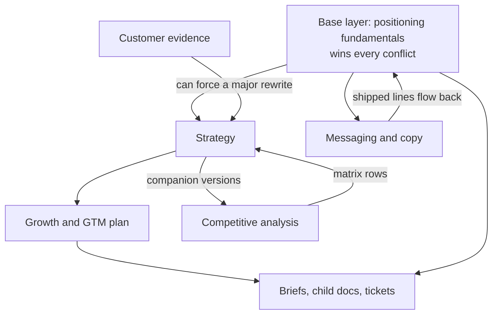
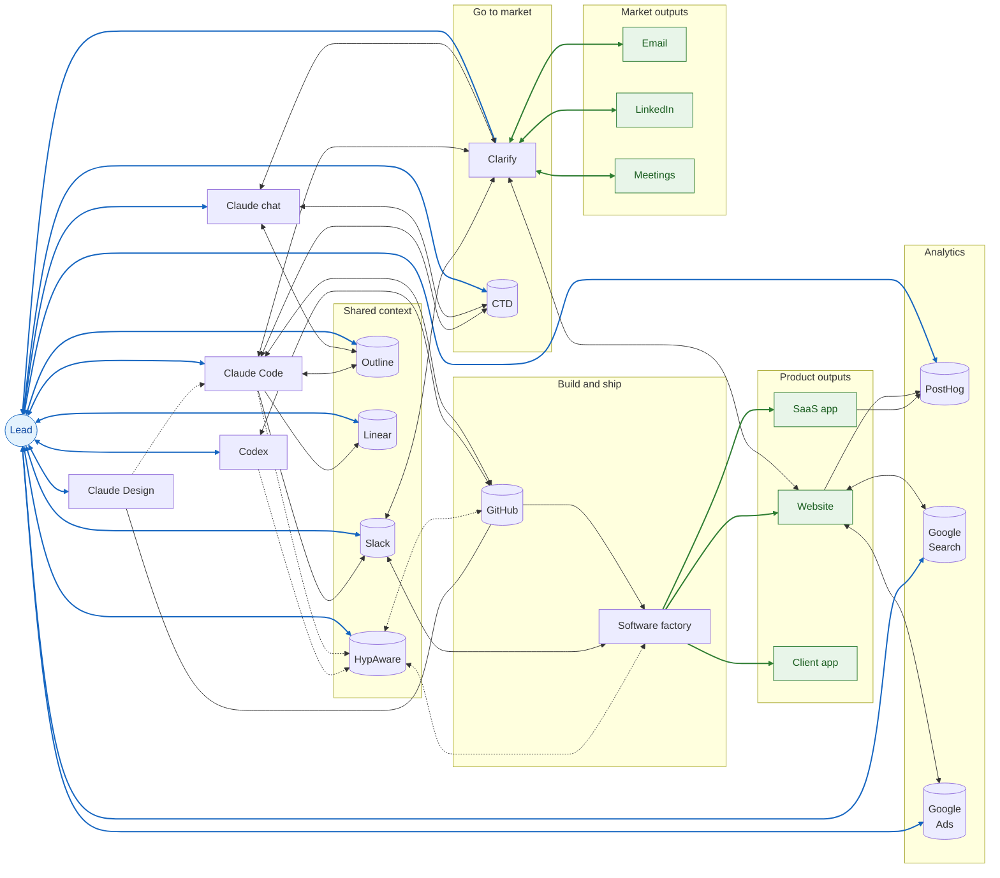
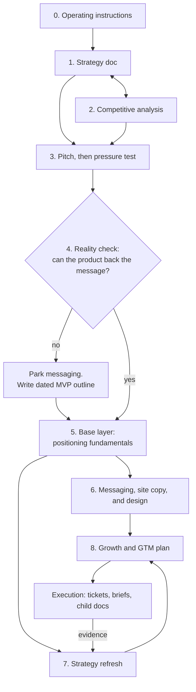

# Agentic Product and GTM Kickstart Playbook

*By Hernan Alvarez, Head of Product and GTM at Hyperparam*

© 2026 Hernan Alvarez. Licensed under [CC BY-NC 4.0](https://creativecommons.org/licenses/by-nc/4.0/). Using it to run your own company's work is fine; see the [README](README.md).

**Version 1.30 - 2026-11-03**

In July this was a side project, an hour or two a week helping a company think through its strategy.

We started with a strategy doc and argued with it line by line until it held up. Then we wrote a 60-second pitch, and a pressure test to try to break it. The founder and I did all of it together. When we dug into the product, it wasn't ready to back the pitch. So we shelved the pitch and set a date for an MVP that people could use and that could prove there was a market.

I went full-time in September, and the MVP launched October 1. We put it in front of a few design partners we knew well, and their feedback shaped the product through October. Meanwhile the go-to-market side got ready for a real outbound push. Today it's a small team plus a set of agents, and we're well on the way to this year's goal of 50 active, qualified design partners.

Chat agents write strategy, positioning, and copy. Coding agents build the site and the product. A software factory ships it. CRM agents generate and score leads, run outreach, book meetings, prep the team before each one, and manage content.

The change that made all of it easier was moving off Word docs and Google Drive onto shared Markdown docs that every agent can read and write. People and agents both read Markdown fine, so a handoff is one sentence: read this doc.

It's what worked for us: an existing team with its own habits, technology that was promising but not yet a product, and an eager, supportive founder.

This playbook is that process with our company taken out. Read Part 1 first. To start, all you need is a chat agent connected to a shared wiki. Then give your agent the whole playbook and say "Read all of this, then start at Phase 0." It drafts each document from what you already have, asks you about the gaps, and argues with you until it's right.

---

# Part 1: For the person running this

## Who this is for

Anyone starting product and go-to-market work who wants agents to do a real part of it. That could be a founder before the first raise, a product leader taking over a new product line, or a GTM leader getting ready for a launch. The process is the same for all of them. What changes is what you start with and who reads the result.

In this playbook, **you** (the person running it) are **the lead**. Your AI assistant is **the agent**.

Terms you'll see:

* **GTM:** go-to-market. Everything it takes to find, win, and keep customers.
* **MCP:** the connection that lets an agent read and write another tool, like the wiki or the tracker.
* **ICP** (ideal customer profile)**:** the criteria you can check to decide whether an account is a fit.
* **Wedge:** the narrow first job that gets you in the door.
* **Base layer:** the one doc that records what's been decided about positioning. It wins every conflict.
* **Category line:** one line that says what kind of product this is.
* **Entry point:** the category or need buyers already search for and have budget for. It's how they find you.
* **Engine:** a repeatable way to get customers, named by what it does.

## What you'll end up with

A set of working documents. Each one has a version and knows which other docs it depends on.

1. **Operating instructions:** how the agent writes, thinks, and talks to you. Everything else inherits them.
2. **Strategy doc:** the market, your wedge, the plan, what makes you different, and what you don't know yet.
3. **Competitive analysis:** a full write-up on each competitor, plus one comparison table (the matrix).
4. **60-second pitch:** beats and script.
5. **Pressure test:** what doesn't hold up yet, and what evidence would settle it.
6. **MVP outline:** the date by which the product has to back the message.
7. **Base layer (positioning fundamentals):** what's been decided. It wins every conflict.
8. **Messaging, site copy, and design:** built from the base layer.
9. **Growth and GTM plan:** steps, owners, and dates, turned into tickets.

## How the documents fit together

The base layer sits on top. Everything else builds from it.



* When the base layer changes, every doc that depends on it gets a small version bump.
* New competitors flow up into the strategy doc as rows in its matrix.
* Customer evidence comes in through the strategy doc, and it can force a rewrite.
* If evidence contradicts the base layer, stop using that claim, flag it, and propose a fix to the lead. The base layer still wins until it's revised. But don't reuse a claim that's been disproved.

## What you need

| Role | Why it matters | What we used |
|------|----------------|--------------|
| Chat agent with projects | Strategy, positioning, copy, and research. Keeps your standing instructions | Claude (chat and Projects) |
| Coding agent | Builds the site, the docs, and anything that ships. Can update docs and tickets on its own | Claude Code, Codex |
| Design agent | Mocks up pages and screens with the lead, at desktop and phone width, starting from the live site. Its decisions go to the coding agent as a brief | Claude Design |
| Shared wiki of Markdown docs, connected to every agent over MCP | **The hub.** Agents and people both read Markdown, so one doc works for both. Every working doc lives here, and it's how agents and people pass work to each other. One agent writes a brief, a copy round, or a result, and the next one reads it by name. Versions go in doc titles. Status goes on the ticket, which links to the doc | Outline      |
| Tracker | Where every step's status lives. The plan links to tickets, and tickets link to briefs | Linear       |
| Repo | Code, site copy, and the rule files agents read (`AGENTS.md`) | GitHub       |
| Team chat | Pings between people, review and merge calls, links to docs | Slack        |
| Software factory | Reviews, merges, and ships whatever lands in the repo. Takes direction in team chat | An internal fleet of coding agents (yours may be CI, a review bot, or a person) |
| CRM with agents | Generates leads and scores them against the ICP, runs outreach, books meetings, preps the team before each one, and manages content | Clarify      |
| Warm-intro graph | Builds outreach lists from real relationships | Connect the Dots |
| Session recorder | A record of every agent session, including the software factory's. Use it to pick up where a session stopped, or to pull real numbers into content. Connected to the repo | HypAware     |
| Product analytics | Website traffic, how people find you, and whether they start using the product. Fed by the website and the product | PostHog      |
| Search | How the website shows up in search, and what people searched to find it | Google Search Console |
| Paid search | Ads that bring traffic to the website | Google Ads   |

**Minimum to start:** a chat agent connected to a shared wiki. That gets you through Phases 0 to 5, which only produce documents. Add the rest when a phase needs it:

* **Phase 6 (copy, design, launch):** coding agent, repo, design agent, team chat, product analytics, search.
* **Phase 8 (growth plan and execution):** tracker, CRM with agents, warm-intro graph, paid search.
* **Optional, any time:** session recorder, software factory.

**Connect every agent to the same wiki before Phase 5.** It's the setup choice that matters most. If you're downloading a file from one agent and uploading it to another, you're the bottleneck, and the copies drift apart.

## How the tools fit together

This is our stack, shown as an example. The table above says what role each tool plays, so swap in your own. Read it left to right. The lead (blue) works with the agents. The agents work through the shared tools in the middle. Two lanes produce the outputs (green), and those feed analytics.



* **Agents.** Claude chat, Claude Code, Codex, and Claude Design are where the lead does the work.
* **Design.** Claude Design mocks up pages with the lead, working from the site in GitHub, and the decisions go to Claude Code as a brief (dotted).
* **Shared context.** Outline is the hub: Claude chat and Claude Code read from and write to it over MCP. Slack is where people, agents, and the software factory meet. HypAware records every session from Claude Code, Codex, and the software factory, and connects to GitHub.
* **Go to market.** CTD is Connect the Dots, the warm-intro graph. Claude chat and Claude Code both work in CTD and Clarify. Clarify's agents generate and score leads, send and receive email and LinkedIn, book meetings, prep the team, and work in Slack both ways.
* **Build and ship.** Claude Code and Codex push to GitHub. The software factory takes what lands in GitHub, gets its direction in Slack, and ships the website, the SaaS app, and the client app.
* **Analytics.** The website and the SaaS app send events to PostHog. The website also connects to Google Search Console and Google Ads. The lead works in all three for website, acquisition, and activation analytics. The website's calls to action send leads to Clarify.
* **The lead** works directly in Claude chat, Claude Code, Codex, Claude Design, Outline, Linear, Slack, HypAware, Clarify, CTD, PostHog, Google Search Console, and Google Ads.

## How it runs

* The agent works one phase at a time, in order. Phases 1 to 3 can loop. Phases 6 and 7 can run side by side once Phase 5 is done.
* For each document, the agent drafts first from what you already have. Then it asks you about the gaps. Then it argues with its own draft. You decide.
* Nothing gets made up. Unknowns go on the open questions list or get marked `[NEED SPECIFIC]`.
* You approve changes before they're made.
* Plan on a few working sessions per phase.
* Work through it with your closest collaborator: a founder, cofounder, or exec sponsor. Share drafts in the wiki as they change, and argue through the pressure test together. You get aligned by doing the work side by side.

---

# Part 2: Instructions for the agent

## How to run this playbook

**First, read everything, then check your connections.** Part 1 holds the terms, how the documents fit together, and the tools. Before Phase 0, confirm you can read and write the shared wiki. Tell the lead which other tools from "What you need" are connected. Missing ones aren't a blocker; flag each one when a phase needs it.

Then follow these rules in every phase:

1. **Draft, then interview, then challenge.** Start each artifact from what the lead already has. Ask questions only where the draft has a gap. Then argue against your own draft before calling it done. Where a phase says otherwise, follow the phase: Phase 1 starts with a challenge, and Phase 3b starts in chat.
2. **Ask a few questions at a time.** Three at most. Multiple choice where you can. Recommend an answer for each.
3. **Never invent facts, numbers, quotes, customers, or dates.** Write `[NEED SPECIFIC]` or add the item to the artifact's open questions. You may propose future dates, targets, and budgets, labeled "Proposed" with the reason. They count only once the lead approves them.
4. **Show changes before applying them.** List the proposed edits; apply after the lead approves. Batch them. A first draft can be saved without approval; changes to approved content can't.
5. **Decisions go last.** End any message that needs a decision with your recommendation, then one yes-or-no question.
6. **Save every artifact to the shared wiki** with the header and version history in T10. If no wiki is connected, say so and save Markdown files the lead can move later.
7. **Close each phase** by checking its "done when" list, stating what's still open, and naming the next phase. Only two checks are gates: the Phase 4 pre-launch check and the go or no-go in 6c. Any other "done when" item you can't meet yet goes on the artifact's open questions with an owner, and the work moves on. Approving a plan never counts as evidence the product works.
8. **Follow the operating instructions from Phase 0** in everything you write.
9. **Positioning is provisional until Phase 5.** Where a template or brief asks for the base layer (category line, persona, ICP, copy rules), use the strategy doc's current answer and label it "Provisional until Phase 5." Phase 5 replaces each one. Other approvals made earlier (operating rules, the naming rule, targets) stand. If inputs conflict before then, use the lead's most explicit answer and log the conflict for Phase 5's conflict pass.

## Order of operations



---

## Phase 0: Operating instructions

**Purpose.** Write down how you'll work with the lead before anything else. That way every later doc sounds like one person, with no filler and nothing made up.

**Inputs.** The lead's role, a few things they've written (emails, posts, docs), and anything they already know they dislike in AI writing.

**Draft.** Fill template T0 from what you can infer from their writing samples. T0's writing rules are examples from one lead: confirm or replace each one. Keep the rules on facts.

**Ask the lead.**

* Who are you, what are you working on, and what are you *not* doing (so I stop suggesting it)?
* How do you want answers formatted? Length, bullets, where decisions go.
* Words or habits you never want to see.
* How should I handle uncertainty and disagreement?
* When I draft in your voice: sign-off, tone, things never to claim.

**Challenge.** Is any rule vague enough that two agents would apply it differently? Rewrite it as something checkable ("no em dashes" beats "write cleanly").

**Done when.**

* T0 is saved where every agent the lead uses can read it: chat preferences, a project doc, and later the repo's `AGENTS.md`.
* There is a place to record new rules as they come up (T13).

**Keep it alive.** When the lead corrects you on the same thing twice, write it up as a rule (T13). When the same rule shows up in a second tool, add it to the project doc copy of T0 so every agent in the project sees it. Product copy rules go in the base layer instead. Tools that can't read shared files (CRM agents, schedulers) need the hard rules copied into their own instructions.

---

## Phase 1: Strategy doc

**Purpose.** A working view of the market, the wedge, the plan, and what you don't know yet. It's meant to be argued with.

**Inputs.** Whatever exists: a one-pager, a deck, notes, a product description, customer conversations. Read each one first and list what's missing or contradictory. That list becomes your first open questions.

**Draft.**

1. **Start with a challenge.** Before you draft anything, poke holes in what the lead has. Ask:
   * What do we do that the nearest incumbent doesn't? Say it in one sentence.
   * Has anyone used that incumbent hands-on?
   * Is there a real customer or design partner, or is this a thesis?
   * What's the retention story after the first win?
2. Then talking points, then the doc (T1). On a first version, Sections 7, 9 and 10 may be thin, and Section 11 holds only the yardstick questions until Phase 2 fills it. Keep each heading, write what you have, and put the gap in Section 13.

Keep these in mind:

* **Wedge versus moat.** The wedge is what gets you in and has a shelf life. The moat is what's left when the wedge gets copied.
* **Structurally can't do.** For each competitor class, what their business model or architecture prevents, not just what they haven't built yet. Treat it as a hypothesis: name the mechanism and what would disprove it.
* **Name the assumption.** If the plan depends on something unproven (for example, "the free product generates the leads"), write it as a named risk with alternatives.
* **Retire on the record.** A dropped wedge, claim, or reason to buy stays in the doc under "what it is not" or "no longer holds," with the reason. Deleted claims come back.
* **Tag every claim by time.** Launch scope, not at launch (Section 1), or long-term (Section 12).

**Ask the lead.** Fill the gaps the draft exposed. One topic at a time. Every target and metric is the lead's call. Propose one, labeled "Proposed," or write "TBD: [who] sets it after [event]."

**Challenge.**

* Get a **cold review**: a fresh session, ideally a different model, reads the doc and reports problems without fixing them (T11). Sort what comes back into fix now, decide then fix, and polish. The lead decides each group.
* Check the phases against the wedge's shelf life. If the plan takes longer than the wedge will last, shorten it and give each phase a clear finish line.
* Check every claim's tense. Present tense only for what exists.

**Done when.**

* Every section has content or an explicit open question.
* No invented numbers.
* The cold review is triaged.
* The doc is written for a neutral reader.
* It has a version and a version history.
* Anything being tested is labeled strawman, with what you expect to learn and where each figure may appear.

---

## Phase 2: Competitive analysis

**Purpose.** Know who you'll be compared to, and what you claim against each of them.

**Inputs.** The strategy doc's competitor section and its matrix questions, the base layer once it exists (it wins on any conflict), plus research.

**Draft.**

* **Sweep by category first:** platform vendors, incumbents in adjacent categories, newer startups, open-source tools, aggregators, and the platforms you'd partner with rather than fight.
* **Then chain:** each competitor's own comparison pages point you to the next. Agree a stopping point with the lead (a source budget, or when new names stop turning up), and list what's left as a research backlog.
* **Set the yardstick first:** the two to four questions from the strategy matrix that separate you from everyone else. Name the table stakes too, so nobody compares on those. Every write-up and the matrix answer the same questions.
* **Settle the naming rule.** Do you name competitors in public, in outbound, or through agents? And say what the doc is for: spotting a competitor a prospect already uses, building the deck, or a later positioning call.
* **Group by category**, each with a short intro on the role it plays for you and which plan phase it matters to.
* **One write-up per competitor** (T2): what it is, capabilities in its own words, a verdict on each yardstick question, structural differences, what's unknown, what it means by phase and by use, what to take, what's owed, re-check cadence, sources with dates and research limits. Mark unverified site claims "per the site."
* **One matrix:** the yardstick questions plus "where it lands." Your product is the first row; rank nearest to farthest; group the tail. Under it, the honest reading: is the gap still open, who's closing it and from where, and who to re-check how often.
* **Write the agent brief.** If an agent works on prospects (scoring leads, drafting replies a person sends, prepping meetings), it gets its own reference brief (T8b), with the audience in the title.

**Rule.** Full write-up in the competitor doc first, then one summary row in the strategy doc's matrix. After the first approved version, add one competitor per minor version, touching its entry, the matrix, and the honest reading. Bump both docs' versions and update the agent brief the same day. Rewrite as a major version when the yardstick or naming rule changes.

**Ask the lead.** Who comes up in real conversations? Who do they lose deals to? Who looks like a competitor but is really a partner? What's the naming rule? Which competitor, if a prospect is happy with it, means they're not a fit?

**Challenge.** Is any differentiation claim something a funded competitor ships next quarter? Move it to "doesn't hold on its own." Is any verdict based only on marketing copy? Say so in the entry, and note that someone still needs to try it hands-on.

**Done when.**

* Every competitor in the strategy matrix has a write-up.
* Entries that aren't competitors sit in their own category, with why buyers raise them and which doc owns the later decision.
* If an agent works on prospects, its brief exists, cites this doc's current version, and has a row for every competitor in the matrix.
* Every entry has a re-check cadence or "alongside [entry]."

---

## Phase 3: Pitch, then pressure test

**Purpose.** Lock how you'll say it, then attack whether the business behind it holds.

### 3a. The 60-second pitch

**Inputs.** The strategy doc, any raw pain material (whiteboard notes, customer quotes), the persona.

**Draft.**

* Two variants that differ only in the pain beat, so you can test them (T3). Write Variant A in full; Variant B is the one paragraph that changes.
* Leave out how it works. That's its own answer.

**Work on beats, not prose.** Break the script into its key points (beats), get those right, and put the script line that carries each one under it.

**Ask the lead.** Which pain do you hear most? Who will say this out loud? It has to work for anyone on the team.

**Challenge.**

* Cut internal labels and consulting vocabulary.
* Write it for what the product has to be. Flag every line that isn't true yet. Phase 4 tests those lines, and nothing flagged goes out in public until it's true.
* Time it out loud. Word counts underestimate.
* Write delivery notes: which beat carries the pitch, how the risky beats have to sound, which line is the only one that creates urgency, and the failure mode at the close.
* For everything left out, say why and where it goes instead (the how-it-works answer, the follow-up), or what brings it back.

**Locked** means approved for the pressure test, not for prospects. Lines flagged as not true yet stay out of conversations until Phase 4 clears them.

### 3b. Pressure test

**Inputs.** The locked pitch, the strategy doc.

**Draft** (T4):

* **Start in chat.** Ask for the three statements first and argue with them. Write the doc once the chat version holds.
* The three statements: pain (in the buyer's words), solution (no architecture), value (in the order a buyer values it).
* Differentiation ranked by how long it survives a funded competitor. Each one opens with a one-sentence claim, names the competitors, and gives durability with its reasoning. Close with an honest ranking: which difference matters, which ones close deals, which are only enablers.
* Why someone chooses you, segmented by why they showed up: who they are, why you win and against whom, deal speed, and whether the plan can count on the segment existing in volume. Include where you lose.
* What doesn't hold up yet, worst first. Each problem opens with a one-sentence claim. Label every number as verified or an assumption, and show the math. End each with what would resolve it and what the plan should assume until then.
* The next 90 days, each action tied to a numbered problem.

**Risk checklist to run:**

* Recognition isn't urgency.
* Your value claim caps your price.
* Proving it worked needs a before and after you can measure.
* Value depends on someone inside the account doing the work.
* Retention after the first win.
* A differentiator nobody is asking for yet.
* A data or privacy question that will surface in procurement.

**Write down, in advance, what evidence would settle each claim.** An item without that line isn't done.

**Keep it alive after it's written:**

* Give every problem a status that changes as evidence arrives: open, confirmed, disproved, or remedy changed. Date each change and link the evidence.
* Cite problems by number in later docs ("risk 5 is now observed, not hypothetical").
* Run a cascade check. When the test says to drop or change a claim, list every doc that carries it and confirm each one changed. The usual failure: a claim gets fixed in one doc and lives on in another.
* When the strategy refresh supersedes it, move every risk that isn't disproved or resolved into the strategy doc's open questions (Section 13), with its number, status, evidence, "what would resolve it," and "until then." Then retire the pressure test by name so nobody quotes its numbers later.

**Challenge.** Did the pressure test overturn anything you told the lead earlier? Say so.

**Done when.**

* Each problem has a "what would resolve it" and an "until then."
* Recommendations that affect other docs are listed so they can be carried over.
* Later docs cite risks by number when evidence arrives.
* You and your closest collaborator are working from the same strategy, pitch, and list of what the pressure test changed.

---

## Phase 4: Reality check

**Purpose.** Before polishing the message, check that the product can back it.

**Draft.** Compare the pitch and the pressure test against what the product actually does today. Start with the lines flagged as not true yet in 3a. Have the lead dig into the product directly: use it, look at real usage, talk to whoever builds it.

**Ask the lead.**

* Does it directly solve the pain in the pitch today?
* What core capability is missing?
* Could a prospect get on it this month and see value?

**If the product can't back the message:**

* Park the messaging on purpose. Keep the drafts, and record why they're parked and what brings them back.
* Write a **dated MVP outline** (T5) around three tests: can we talk to people about it, can they get on it, can we prove it worked for them. Define the happy path: the setups where the product works today. Those become the filter for who you reach out to.
* From here on, every doc separates **shipped** from **planned**.
* The MVP includes the storefront: a live site, self-service sign-up that works end to end, legal pages (privacy policy, terms), and core content like solution guides. On launch day you should look open for business, even if the big go-to-market push comes later.
* Open for business includes the look: every launch page in one visual system, readable at phone width. Run the first design pass (6b) once the pages have copy.
* The MVP outline lets you move on to Phases 5 and 6 while the product is built. It doesn't clear any line flagged as not true yet. Before launch, run this check again against the product as built and the T5 checklist, and record the evidence and the lead's go or no-go.

**Done when.**

* Either the product backs the pitch, or there's a dated MVP outline with what ships under what name, product areas with status, focus areas, the launch checklist, how you'll know it worked, and asks for the team.

---

## Phase 5: Base layer (positioning fundamentals)

**Purpose.** One document of what's been decided. Every other doc, agent, and page builds from it. When anything conflicts with it, it wins until it's revised.

**Inputs.** Everything so far: strategy doc, competitive analysis, pitch, pressure test, MVP outline, customer feedback, usage data. Put them all in one shared place on one day.

**Draft.**

1. **Conflict pass.** Read every input against the launch plan. List every place they disagree. Propose a resolution for each that says what's true at launch, what's true long term, and what copy can and can't claim as a result. Title each one with its resolution.
2. Write the base layer (T6), with the precedence line and the named, dated sources in "How to read." Version 1 comes from the first session. The site and copy sections fill in as copy rounds land.
3. Date every decision where it lives ("approved [date]", "retired [date]"). Point to other sections by number instead of repeating a fact.
4. For each "remove this everywhere" decision, add an open item naming the other doc and the sections to rewrite.

**Ask the lead.** Decide each conflict. One at a time, recommendation first.

**Sections that do the most work:**

* **Shipped versus planned:** capability, status, and notes (ticket, who confirmed, date, what must be true before it's claimed). "Do not claim" is a status. Confirm shipped status with whoever builds it. A closed ticket isn't a shipped feature.
* **Category decision:** the line, the part that never changes, the lines it replaced with their dates, each rejected alternative with its reason, and what does not change. Test it on a person, on an agent relaying it, and against every channel's length limit.
* **Core construct** (if the product hands back a distinct unit of value): what it is, and, if you need both, an internal name and a customer-facing name and which goes where.
* **Persona and ICP:** the eight persona fields in T6. The ICP in four lists: qualifies, prioritize, disqualifies, doesn't matter.
* **Copy rules:** never and always lines, rules that differ by channel, vocabulary with its date, and retired phrases with the date and the replacement.
* **Recorded deviations:** when the lead breaks a rule on purpose, who decided, when, and why it stays.
* **Proof ledger:** what customer proof exists and whether each customer approved citing it.
* **Long-term notes**, kept out of launch copy, each saying where it belongs instead.

**Challenge.** Every claim checked against data, customer words, or the shipped table. Customer proof stays out until the customer approves it. Quotes illustrate the persona; they don't define it. Don't conclude what a customer lacks from one data source.

**Done when.**

* Every input conflict is resolved in writing.
* Every other doc names the base layer and its version in its header.

**After launch.** Run a dated staleness pass: compare the site and shipped sections with the live product and log each mismatch in Open items. It's a follow-up, and Phase 6 doesn't wait on it.

---

## Phase 6: Messaging, site copy, and design

**Purpose.** Turn the base layer into the words and the look people see.

### 6a. Copy

**First round, for a new site.** The chat agent drafts the full copy for every page from the base layer's site structure (T6, Section 8) and proposes where the copy file will live. Once the lead approves it, the coding agent builds the pages from it. Every change after that is a copy round.

**How it runs** (two agents, one shared wiki):

1. The chat agent writes a **copy round** (T7) and saves it to the wiki: what changes (the current line and the new one), the working rules, the changes to the copy file, and the checks that define done.
2. The lead tells the coding agent: "Apply round [name] from the wiki." The agent changes the copy file first, makes the pages match, runs the checks, and reports each check with its result and anything that didn't apply cleanly.
3. The lead reviews the result before it goes live and approves it.
4. For an audit, the chat agent reads the result in the wiki, checks it against the brief, and writes the critique there for the coding agent to pick up.

**Rules.**

* Nothing claims what isn't shipped.
* When a vocabulary or category decision changes, roll it out everywhere at once: site, docs, repo README, package listings, anything agents read.
* Once copy is live, the copy file decides what every visible line says. The base layer quotes the lines positioning depends on, verbatim, with the file name and date. When a later decision changes a quoted line, leave the quote as shipped and flag it until the next round ships.
* Decisions made in copy rounds (deviations, tone, scope, retired phrases) go back into the base layer as a new version that lists the rounds it came from.

**Done when.**

* Every page traces to the base layer.
* Pages agents read (for example `llms.txt` and Markdown versions of pages) match the ones people read.

### 6b. Design

**Purpose.** Give the site one look before launch, and keep it consistent after.

**How it runs.**

1. The chat agent writes a design brief (T14) from the base layer: what the page or screen is, references to follow and avoid, what's fixed, what the design agent may propose, and which screens to produce.
2. The lead iterates with the design agent on mockups, working from the live site so the design starts from what ships. For a new site, it works from the approved copy and the brief's constraints and proposes the first visual system.
3. The design agent or the chat agent writes the decisions up as a task brief (T8a) for the coding agent, with the mockups attached for reference. Where the brief and the mockups disagree, the brief wins.
4. Build and review, as in 6a.
5. A decision that changes the look for good goes into the base layer's visual identity section.

**Rules.**

* Copy first. Text a design adds goes into the copy file before the build.
* Anything the build needs from the mockups is written into the brief.

**Done when.**

* Pages in scope match the brief at desktop and phone width.
* The base layer's visual identity section matches what shipped.

### 6c. Launch

Build and review copy and design on a preview before anything goes to the live site. When both are approved, rerun the Phase 4 check against the product as built and record the lead's go or no-go. Then publish.

**Done when.**

* Everything for launch is live and matches the base layer: site, self-service sign-up, legal pages, solution guides, and marketing materials.

---

## Phase 7: Strategy refresh

**Purpose.** Rewrite the strategy against the base layer and the evidence gathered since the original thesis.

**Draft.** A major version, rewritten against named inputs: the base layer, the pressure test, the competitive analysis, usage data, customer conversations, the MVP scope. List those inputs in the version history. Rewrite sections, don't patch them, and keep T1's section order so other docs can cite sections by number.

**Patterns to use:**

* **"How to read this document":** what changed underneath, in one paragraph.
* **Holds / no longer holds:** each differentiator sorted, with the precise replacement claim.
* **Now versus later:** a "not at launch" list, and long-term strategy in its own section.
* **Evidence with counts**, plus caveats about how reliable each count is.
* **Strawman labels** on anything being tested, with what you expect to learn.
* **Customer words** quoted as the reason for a reversal.
* **Superseded docs named,** including the pressure test, so nobody quotes stale numbers.
* **Evidence tied back to the plan:** a closing subsection that says what the evidence changes and cites pressure-test risks by number.
* **Unset numbers stay unset:** "TBD: [who] sets them after [event]. Do not invent them."
* **Where a figure may appear:** site, outbound, agent replies, or spoken only.

**Keep it current.** After the major version, bump a minor version whenever a companion doc changes something this doc carries (a new competitor row, a category line, a vocabulary change). Name that doc and version in the entry and update the header references in the same edit.

**Done when.**

* The doc matches the base layer.
* Open questions carry an owner, or say who decides.
* Section 11 matches the competitive analysis version named in the header.
* Everything superseded is retired by name.

---

## Phase 8: Growth and GTM plan

**Purpose.** A plan the team reads in two minutes and the agents can execute step by step.

**Draft** (T9):

* An exec summary the team can act on: the goal, the metric, the message, the engines in order, a to-do per person with a section number, and key dates.
* Which doc wins: the base layer on the message. On what to do, this plan beats the strategy doc until the strategy is revised.
* Engines, ranked, each named by the job it does. Propose them with the evidence for each (what's already producing, who you can reach, what it costs); the lead ranks them. Say which one produces paying customers. The lead approves review thresholds before execution.
* A timeline grouped by phase: step number, date, step, owner, status. Owners can be agents ("chat agent drafts, lead publishes"; "coding agent").
* A day-by-day playbook for each launch moment.
* Instructions for anything one person will run alone. Record what was built, the checks, and when to review it, with thresholds. Skip screen-by-screen steps for tools whose interface changes; name the setting and say to look for the equivalent.
* Measurement: where each number lives, a tracking tag per channel, weekly and monthly checks, and a rule for cutting a channel that produces nothing.
* Not doing, with what would bring each item back.
* **Stage the motion.** Start with a few design partners from warm contacts. Use their feedback to shape the product and the message before anything scales. Then get ready for the full outbound push: lists, sequences, meeting prep, and the instructions your CRM agents run on. Before outbound starts, agree with the lead what the design-partner stage has to show and when you'll review it.

**Turn it into execution.**

* Every timeline row becomes a ticket. Ticket titles start with the plan's step number ("3.08 Launch day"). Descriptions name the plan section, list numbered steps marked "Done [date]" as they finish, refer to other steps by number, and end with "Done when." The ticket ID goes in the timeline row.
* Each ticket that needs an agent gets a **brief** (T8a) in the wiki, linked from the ticket.
* Sections that become deliverables move to child docs (T9a) nested under the plan, with the version in the title. The parent section says "Superseded. The final text is in the child doc [title vN] ([ticket])."
* Every public number in a child doc carries its source: the query or method, the window, and what's off or uncertain. Nothing from a customer goes public until the customer approves.
* Once tickets exist, the tracker owns live status. Rewrite the plan to match what was actually built.
* Keep an index doc (T9b; a content calendar, for example) under the plan, with date, item, channel and account, owner, ticket, draft link, and status. Status records what happened: the live link, a moved date, a drop and why. Between plan versions the index is the current view: say which date it matches the tracker as of, and end with the gaps.
* Decisions waiting on the lead are marked "Needs go" in the timeline and listed under Open decisions with what they wait on. Delete them once resolved and say so in the version history.

**Done when.**

* Every step has a ticket and an owner.
* Every agent task has a brief.
* The plan links to the tracker for status.
* Every child doc and the index link back to the plan section and the ticket.

---

# Part 3: The operating system

## Versioning

* **Header** on every doc (T10): purpose; version and date; companion docs with exact versions, including which one is the base layer; what it supersedes.
* **Major version:** a rewrite against named inputs. **Minor version:** absorbs exactly one thing: a dependency change, a structural fix, one new competitor, one batch of decisions. Small bumps are cheap. Make them often, once a doc is approved. Until then, a first draft is one version, however many changes it goes through.
* **A reference update isn't a version.** Updating a companion doc's version in a header doesn't bump this doc or start another round of updates. When one change touches several docs, update them as one batch and record it in each history.
* **Version history** at the bottom, newest first: date, what changed, and why.
* **Version in the title**, so every link shows which version it points to.
* **Date decisions inline** ("since [date]"), so readers can see what may be stale.
* **Retire on the record.** Superseded docs, dead claims, and old phrases are named and dated, not silently deleted.
* **One live copy.** A doc lives in the wiki from its first version. If it starts somewhere else, declare the wiki copy the source of truth the day it moves. Two live copies drift within days.
* **Check for stale docs** on a schedule. A doc built from another one falls behind it. Log the gaps as open items.

## Handoffs between agents

* **A handoff is a prompt.** Every brief, round, and handoff lives in the wiki, and the lead tells the next agent to read it by name. An agent the wiki can't reach gets the same doc as a file, or a reference brief (T8b).
* **Briefs hold the job.** A task brief (T8a) links the source of truth, says which doc wins, and gives the scope, the procedure, flags, and the acceptance the output has to show. It doesn't restate the operating instructions or `AGENTS.md`; a connected agent reads them. The more an agent can read, the more the "which doc wins" line matters, because it will find stale and conflicting docs.
* **Reference briefs are for agents that work from their own instructions** (T8b), such as CRM agents. They carry every hard rule inline and list what changed at the top, since those agents can't see version history.
* **Status lives on the ticket.** Versions live in doc titles. Where a piece of work stands lives on its ticket, which links the doc. Status shown anywhere else (a plan's timeline, an index, a doc header) is a snapshot as of its date; check the ticket before acting.
* **Audience in the title** for agent-facing docs ("for the CRM agent," "coding-agent instructions").
* **Long sessions end with a handoff doc** (T12), holding only what the repo, the tracker, and the wiki don't: what the session was doing, decisions and rules not yet written to their homes, what's waiting on whom, and the next steps. Start the next session with "Read [handoff] first." A session recorder lets a new session rebuild context if one is lost.
* **Changes for another repo or agent go as tickets,** each linking a copy round (T7) or a task brief (T8a). If the agent doing the work can't read the tracker (a bot that only reads the repo, for example), also file an issue or PR in its repo and link it from the ticket. The ticket owns status.
* **Design handoffs carry decisions.** The mockups are reference only. The brief wins where the two disagree, and every value the build needs is written into it.
* **The lead still approves** every merge, send, and publish.

## Keeping rules alive

* A correction made twice becomes a rule (T13).
* Every rule has one home: how you work with the agent goes in T0, product and copy decisions in the base layer, repo procedures in `AGENTS.md`. When a rule shows up in a second tool, copy it there and cite its home; the home doesn't change. Mechanical rules (like banned characters) get an automated check.
* Agents without shared memory get the hard rules written into their own instructions. When a source doc changes version, update the agents that cite it.

---

# Part 4: Templates

Copy each into the wiki as its own doc. Fill the brackets. Every standalone doc gets the T10 header and version history, even where a template leaves them out for brevity.

## T0. Operating instructions

The writing rules below are examples from one lead. Confirm or replace each with yours. Keep the "How to think" rules on facts. Format each deliverable for where it's going: editable prose for copy, code blocks for commands and text pasted into a tool.

```
## Who I am
[Name], [role] at [company]. I'm working on [areas]. Key people: [names, roles].
[Background the agent should know, in one or two lines.]
I am not [things the agent should stop suggesting].

## How to write to me
- Lead with the answer, then the reasoning. Brief; bullets when there's more than one item.
- Never open with a compliment, a restatement of my question, or a preamble. Don't close with a generic offer to help; name the next step if there is one.
- [Formatting rules, e.g. no em dashes.]
- Banned words: [list]. Specifics and numbers instead of adjectives.
- Decisions: your recommendation first, then one bolded yes-or-no question, last in the reply.
- Anything I'll paste elsewhere, or into another agent, goes in a code block.

## How to think
- If you don't know, say so in one line. Don't invent facts, numbers, quotes, or dates; write [NEED SPECIFIC].
- Cite primary sources. Separate what a source says from what you infer, and what's verified from what's assumed.
- Have a view. Recommend one option and say why.
- If I'm wrong, say so directly; don't soften it into a suggestion. Correct my terminology in one line.
- When I push back and I'm right, update. No apology paragraph.
- Read [tracker] and [wiki] before answering about status. Don't guess.

## When drafting in my voice
- [Tone in one line.] [Typical length, e.g. three to five sentences for an email.]
- Open with something specific, not a pleasantry. Say what will happen, not that something will.
- Keep my actions and the other person's in separate sentences.
- Sign-off: [exact text, per channel].
- Never invent a number, date, title, or claim about me. Ask.
- [One or two before/after pairs in my voice.]

## Writing pass on every draft
- [e.g. read it aloud; cut press-release sentences; vary sentence length; one exclamation point at most.]

## Rules added as they come up
- [Rule] ([date]). [Product copy rules go in the base layer, not here.]
```

## T1. Strategy doc

```
[T10 header]
*Working draft, not for external distribution. Built to be argued with.*

# How to read this document
[One paragraph: what this version is written against (what ships, what customers said, what the evidence shows), what the last version assumed that turned out wrong, and what it supersedes. On a first version: what it's built from and what is still thesis.]

# 1. What [product] is, and what ships at launch
[One paragraph: what it is, the kind of work or data it handles, why existing tools don't handle it, and what makes it possible.]
* **What a customer buys:** [The thing they pay for, in the base layer's category line. The internal word if it differs from the site word. The first market.]
* **Launch scope:** [What ships on [date]: install path, sources or integrations, where data lives, what runs where. A dated note for anything removed.]
* **Not at launch:** [Each thing people assume is included and isn't. Point to Section 12.]
* **Technical foundation:** [What it's built on, adoption that predates this product, and retired descriptions that must not return.]

# 2. Market framing
* **Adjacent market:** [The market you're sized against, a sourced figure or [NEED SPECIFIC], the vendor classes in it. Whether you sit in it or above it.]
* **The contrast:** [What that market gives the buyer and what you give instead, in one or two sentences.]
* **The way in:** [What buyers already search for and budget for, and how you meet them there. Date if decided.]
* **Why this segment first:** [Why value and data arrive fastest here. What early customers have in common.]
* **Bottom line:** [Whether the pain is real, and the real question a buyer or investor asks. Point to the section that answers it.]

# 3. The wedge
* **What it is:** [The narrow first job, defined so it's checkable. If it replaced an earlier definition, what was wrong with the old one.]
* **What it is not:** [The retired reason to buy, with the customer's words as the reason. Where it was removed.]
* **Evidence it works:** [Best case and counter-cases, with counts. One line on what the split means.]
* **Shelf life:** [Who is moving toward this, from which direction, with what distribution. The precise claim that still holds and for how long.]

# 4. The plan
[One line: what this plan replaces, if anything.]
## 4.1 [First window]: [start date] to [end date]
* **Gate, [date]:** [What must ship or be true.]
* **Targets by [date]:** [Funnel numbers, from the lead.]
* **What has to be true to hit them:** [Product or process items the targets depend on, ranked ahead of new scope.]
* **Proof asset:** [The one citable result, the permission it needs, and what you rest on until you have it.]
## 4.2 [Second window]: to [date]
* **Shape:** [Three or four moves, in order.]
* **Metrics:** [Numbers, or "TBD: [who] sets them after [event]. Do not invent them."]
* **Tradeoff to keep naming:** [What runs in parallel on a small team, and that it's a choice.]

# 5. What holds against incumbents, and what no longer does
## Holds
* **[Claim, stated precisely]:** [What each named competitor does instead, one verb each. What in their model or architecture stops them.] [Tag "(long-term)" if it's not a launch message.]
## Unproven
* **"[Claim the lead keeps]":** [The evidence against it and its source. Why the lead keeps it. What would settle it. Internal only until settled.]
## No longer holds on its own
* **"[Former claim]":** [Who contests it or where it's only partly true. The precise replacement, where it now lives, and what brings it back.]

# 6. GTM motion
* **Motion type:** [How first customers arrive and who they are. Who installs, decides, pays; say if they're one person. What gates the deal and what doesn't.]
* **Qualify on / Prioritize on / Disqualify on:** [Checkable criteria for each. Point to the full ICP in the base layer.]
* **The trigger:** [The moment that makes them act, separate from how the message reaches them.]
* **Sequence:** [Each step from first contact to paid, with the pages or commands involved.]
* **Calls to action:** [Primary and secondary, and the condition under which each stays accurate.]
* **Not this push:** [Deferred motions, personas, hires, and what brings them back.]
* **Second-order lead sources:** [Channels kept but secondary. Point to the growth plan.]

# 7. Packaging and pricing (strawman, experiment)
[Source of the tiers and its date, with corrections. Define the billing unit and any word that reads two ways. Say it will change. Site status as of [date]: what the pricing page shows.]
| Capability | [Free or reference] | [Tier] | [Tier] | [Tier] |
| [Capability] | [Value] | [Value] | [Value] | [Value] |
| Price per [unit] | | [Price, or "not on the site"] | | |
| Call to action (site) | | | | |
* **What the tiers mean for the plan:** [On-ramp tier, conversion target this window, tier for a later step.]
* **What to learn:** [Each question, and whether the site or conversations answer it.]
* **Rules:** [Where each figure may and may not appear: site, outbound, agent replies, spoken only.]

# 8. [Distribution lever, e.g. open source or free tier]: role in GTM
* **Role:** [What it does for the motion, and what it is not.]
* **What's included:** [Components in it; what's built but left out.]
* **Reality check:** [Who already offers this free, and what earns it a place anyway.]
* **Open item:** [What a prospect will look for that's unresolved. Who decides.]

# 9. Evidence to date
## 9.1 [Outcome evidence] ([source], data through [date])
* **Volume:** [Counts by customer type. Whether any is cleared to cite.]
* **Where it worked:** [The case with counts, and the cases where it didn't.]
* **Quality:** [How often output was usable as delivered; the gap that shows.]
* **Patterns:** [What recurs across customers, with counts, and which story it supports.]
* **Count reliability:** [Which counts are floors or partial, and why.]
## 9.2 Usage ([source], data through [date])
* [What customers did, with counts. Where they stopped. Whether anything compounds. What sticks, and whether it should lead.]
## 9.3 What the evidence says about the plan
* [Each conclusion that changes the plan or confirms a pressure-test risk. Cite the risk by number.]

# 10. Ecosystem and integration targets
* **[Category]:** [Partner, integration target, source of erosion, possible acquirer, or later channel. What you'll do now and what you defer.]

# 11. Competitive matrix
[Summary only; full write-ups in [competitive analysis vN]. Uses the same yardstick questions as the competitive analysis.]
| Entry | [Question 1] | [Question 2] | [Question 3] | Where it lands |
| [Your product] | | | | |
| [Competitor or class] | | | | |
[Reading: who has the separating answers and on what lever, who's nearest and on what ground, who has more distribution, who becomes a competitor if you expand, who to re-check and how often.]

# 12. Long-term strategy (kept out of launch messaging)
* **[Direction]:** [What it is, who asked for it, and what brings it into the plan.]

# 13. Open questions and items to validate
* [Written as a question. Owner and date if known; otherwise who decides, or [NEED OWNER].]

# 14. Version history
[T10 format. A major version lists the inputs it was rewritten against and what it supersedes. A minor version names the companion doc and version that drove it.]
```

## T2. Competitive analysis

```
[T10 header. Add: "Full write-ups behind the competitive matrix in [strategy doc vN, section N]." Mark it working notes, not for external distribution.]

[Rewrites only: one paragraph on what changed underneath every comparison (a redefined term, a dropped claim, a new naming rule) and what did not (research, sources).]

# How to read this document
[What each entry covers. The yardstick: the [two to four] questions from the strategy matrix, stated exactly, that every entry and the matrix answer. The table stakes almost everyone has, named, with "these are not the comparison."]

## The naming rule
[Whether competitors are named on the site, in outbound, and by agents, and since when. What to do when one shows up in a prospect's stack (for example: recognize it, route the conversation, don't argue). Who this doc is for: which conversations, which deck, which later decision. Entries included only because buyers will raise them.]

# [Letter]. [Category name]
[One to three sentences: what this category is, the role it plays for you (the floor every prospect already has, a collection path, an integration target, the peer set, a packaging comparable), and which plan phase it matters to. Entries added since the last major version, and why each matters.]

## [Competitor name] ([domain])
**What it is:** [One paragraph: what it is, company, funding, buyer, launch date, pricing, deployment. Disambiguate any company with the same name. Write "not found in the sources checked as of [date]" for each fact you couldn't find.]

* **[Capability label, e.g. coverage / how it collects / pricing / in its own words]:** [Specifics with numbers, dates, and short quotes from its own materials. Write "per the site" for anything unverified, and say whether a sample figure is customer data or illustrative.]
* **What it does not do:** [Only limits its own site, docs, or changelog state, and where you looked. Something you didn't find is "not found," not a gap.]

**Compared to [your product]:** [One sentence placing it: nearest on which ground, or not on your ground. A verdict on each yardstick question in order (yes / partly / no / unverified), each with its reason. The structural differences a feature list hides: business model, incentive, buyer, install path, or a choice your base layer rules out. What is unknown and matters most.]

**What it means for us:** [Competitor now, or from which plan phase. One line for each place it changes something: what to say if a prospect runs it, the deck, the roadmap, the ICP (is a happy user a disqualifier?). What to take from it. Vocabulary it owns that collides with yours, and the rule that follows. Owed: [demo / hands-on test / question to answer]. Re-check: [cadence, or "alongside [entry]"].]

*Sources: [pages or URLs, with dates]. Research limits: [sole source / pages that didn't render / what couldn't be found], as of [date].*

# [Letter]. [Category] (not competitors: [why buyers raise them])
* **[Names]:** [Why they come up, the relationship today (complementary, partner, possible acquirer), the decision recorded, which doc owns the later decision, and what may be said in public.]

# [Letter]. [Yardstick name] across every entry
*The [N] questions from the strategy matrix, applied to every entry. Ranked nearest to farthest.*

| Entry | [Question 1] | [Question 2] | [Question 3] | Where it lands |
|---|---|---|---|---|
| [Your product] | [Your honest answer; "in scope [date]" if not shipped] | [Same] | [Same] | [What you claim, in one line] |
| [Nearest entry] | [Yes / Partly / No / Unverified, with a short reason] | [Same] | [Same] | [Its position and what to do about it] |
| [Tail entries, grouped] | [Shared verdict] | [Shared verdict] | [Shared verdict] | [Their role, e.g. the floor, integration targets] |

**The honest reading:** [Is the gap you claim still open, and from which directions is it closing. Each entry to re-check, why, and how often. One closing line on what everything else does instead.]

# Version history
- vX.Y (YYYY-MM-DD): added [competitor] ([entry, matrix, honest reading]). Research from [sources]; [what couldn't be found]. Companion versions updated: [docs and versions]. Agent brief updated: [title vN].
```

## T3. 60-second pitch

```
[T10 header]
*Two variants. Same structure, different pain beat, so the A/B test stays clean. About [N] words, [N] seconds out loud. Speaker: anyone on the team.*

## Variant A: [short name for the pain]
> [The full script, as spoken.]

## Variant B: [short name for the pain]
*The pain paragraph only. Everything else is identical to Variant A.*
> [The one paragraph that differs.]

## The beats
*Memorize the beats. The quoted line under each one is what carries it.*
1. **Who's speaking.** "[line]"
2. **Who it's for, and their situation, stated plainly.** "[line]"
3. **The pain, concrete and recurring.** A: "[line]" B: "[line]"
4. **Why now.** "[line]"
5. **What we do, in one line.** "[line]"
6. **What they get, in their words.** "[line]"
7. **Why believe us** (only proof that's true today). "[line]"
8. **Hand it back with a question. Stop.** "[line]"
[Split a beat when the script needs it. Keep one quoted line per beat.]

## Not true yet
- **"[Line]"** (beat [N]). [What has to ship or be proven before it's true. Phase 4 closes it. Not said in public until then.]

## Delivery notes
- **Beat [N] carries the whole pitch.** [What happens if it lands wrong.]
- **Beat [N] has to sound like [how].** [The failure mode if it's delivered the other way.]
- **Beat [N] is the only urgency.** [Don't cut it for length.]
- **The last beat is a full stop.** [The failure mode: filling the silence.]

## What is deliberately not here
- **[Claim or detail].** [Why it's out: wrong moment, invites the wrong questions, not true yet, over-rotates. Where it goes instead (the how-it-works answer, the follow-up), or what brings it back.]

## How to run the A/B test
Owner: [name]. Review on [date]. Decision it informs: [which variant to keep, or what to change].
[Why you aren't measuring conversion, if the sample is small.]
- [Signal, e.g. does the speaker get interrupted before the closing question?]
- [Signal, e.g. is the answer to the closing question real or polite?]
Alternate strictly: A, then B, then A. Don't blend them mid-conversation.

## Results
| Date | Variant | Who | Interrupted? | Answer (real / polite) | Note |
```

## T4. Pressure test

```
[T10 header]
*Working notes, not for external distribution. Companion to [pitch doc vN].*

## 1. The three statements
**Pain.** [Who feels it, what it costs them, and why they can't see or fix it today. In their words.]
**Solution.** [What you do about it, in two sentences. No architecture.]
**Value.** [The two or three things they get, in the order the buyer will value them.]

## 2. Why we're different
*Ranked by how long each difference survives a funded competitor.*

### [Difference, stated as a one-sentence claim]
[What competitors do instead, by name. Whether this is a difference in kind or only in degree, and why.]
**Durability:** [high / medium / low, or "permanent against X, zero against Y"]. [What it would take to copy it. Caveat if durable isn't the same as hard.]

**The honest ranking:** [Which difference matters, which ones close deals, which is only an enabler nobody buys on its own. Which ones a funded competitor could take, and what stops them.]

## 3. Why someone chooses us
*Segmented by why they showed up. The reason to buy is different in each.*

- **[Why they showed up].** [Who they are. Why we win, and against whom. Deal size and speed. Whether to target them deliberately, and whether the plan can depend on this segment existing in volume.]
- **Where we lose.** [The account profile to qualify out early, and why.]

## 4. What doesn't hold up yet
*Worst problem first.*

### [N. The problem, stated as a one-sentence claim]
[Why it's a problem, and why it hides in a normal review. Label every number as verified or "Assumption, not verified," and show the math.]
**What would resolve it:** [The specific evidence: which customer, what behavior, by when.]
**Until then:** [What the plan should and shouldn't assume.]
**Status:** [open / confirmed / disproved / remedy changed] ([date], [evidence])

## 5. Recommended next 90 days
- **[Action].** [Which numbered problem it resolves, and why it beats the alternatives.]

## Carry-overs (cascade check)
| Recommendation | Docs it touches | Applied? (doc version) |
```

## T5. MVP outline

```
# [Product]: path to [date] MVP
*Working outline for [meeting]. Ends in decisions.*
Goal: [what a confident MVP means] by [date], so we can [what it makes possible, e.g. start outbound to N design partners] through [sourcing channel].

## 1. What we're shipping, under what name
[Naming and packaging changes for the window. If not final, run it as a time-boxed experiment and say how you'll judge it.]
- [Free or open tier: what it is and its limits.]
- [Paid tiers: what each adds. What must exist on the date (pricing and docs pages) versus what gets built later.]
- [Surfaces renamed or folded in.]
- Out of scope for [date]: [products or features excluded entirely].
- Open question: [the packaging call still undecided, and what it depends on].
Why this matters for [date]: [why outreach can't start without it].

## 2. Product areas
1. **[Area]:** [What it does. Built / not built / scoped to [tier or later phase].]
2. **[Area not yet defined]:** [Who raised it. To be scoped in this meeting.]

## 3. Focus areas for the [N]-week sprint
**[Focus area].** [The problem a real user hit, and why it blocks broad outreach.]
**Define the happy path.** [Which environments you can succeed in today. This becomes the qualification filter for outreach: disqualify outside it rather than support everything.]
**Engagement loops.**
- [Time to first value: where it lands today and where it has to move.]
- [What people get out of it, in a form they can act on.]
- [The loop that brings people back.]

## 4. Open for business on [date]
- Site live, copy traced to the base layer
- Self-service sign-up tested end to end
- Pricing and docs pages. Anything not built yet is labeled planned and has no buy or sign-up button; the lead decides whether it appears at all
- Legal: privacy policy, terms [others as needed]
- Solution guides and core marketing materials
- Agent-readable surfaces (llms.txt, markdown pages)
- One look across every page, checked at desktop and phone width

## 5. How we'll know it worked
- [The customer outcome to prove, the evidence that shows it, who checks it, and when. Criteria the agent proposes are marked "Proposed" until the lead approves them.]

## 6. Asks for this meeting
- Agreement on [date] as the target, scoped to [what].
- Agreement on [naming or packaging direction].
- Define [open area]: what it is, and whether it's in scope.
- Prioritization of the focus areas against the window.
- Sign-off to start [outreach] once the MVP lands.
```

## T6. Base layer (positioning fundamentals)

```
[T10 header]

# How to read this document
This is the base layer. It records what was decided, not what is being explored. When another document conflicts with this one, this one wins until it is revised. [One sentence naming the sections in order.]

Sources: [each input this version rests on, named and dated: interviews, onboarding notes, usage data, feedback. Customer quotes here illustrate; they don't define.]

# 1. What [product] is
[One paragraph: what it is, the kind of data or work it handles, why existing tools can't handle it, and what that makes possible.]
- **What the customer buys, and what makes it possible.** [The thing they pay for, and the capability underneath. Which one the launch message leads with.]
- **The problem shape.** [Why current tools fail on this shape of problem, in two or three sentences.]
- **The answer.** [How the product handles it, in one sentence. Status per component lives in Section 9.]
- **Placement.** [Where this argument lives on the site, and what's held for later (Section 11).]

# 2. Resolved conflicts
[How many conflicts between the inputs and the launch plan were resolved, and on what date. Later ones carry their own date.]

## 2.[N] [Topic]: [the resolution in a few words]
- [What's true at launch.]
- [What's true long term.]
- [What copy can and can't claim as a result, and for which tier or audience.]
- [Anything to remove everywhere. Each doc still carrying it gets an item in Section 12.]
- [Customer words or data that confirm it, quoted and attributed.]
- [Correction ([date]): what new evidence changed, and the more precise claim that replaces the old one.]

## 2.[N] Category and entry point (resolved [date])
- **The line.** "[Category line]." [Same words everywhere. The shorter variant for channels with a hard length limit, and which channels. Each line it replaced, with the dates it ran and why it was dropped.]
- **The durable part.** [The words that never change, the ones people and answer engines attach to the product.]
- **One line for people and agents.** [How it reads true to a person and to an agent relaying it. The rule for surfaces agents read.]
- **Entry point.** [The existing category buyers already search for and budget for, and where the product sits relative to it. The phrase to use and the phrase retired.]
- **Why.** [Each alternative weighed, with the one-line reason it lost.]
- **What does not change.** [Persona, ICP, outbound focus. Whether the line is wider than the ICP on purpose, and how the next sentence in copy covers the gap.]

# 3. [Core construct, if the product has one: the unit of value it hands back]
[The internal name and the customer-facing name, the date the naming rule was set, and why the internal name stays out of marketing copy.]
- **[Part]:** [What it is, with one concrete example.]
[Which part is the unit, and how the others relate to it.]

# 4. [The customer situation the message is built on]
[The situation in two or three sentences: what the buyer runs, where the volume is, how it fails.]
[What's known about each early customer's version of it, and what isn't yet. What not to conclude from one data source.]
**Word choice:** [Vocabulary choices the lead has made for this situation, and why.]

# 5. Persona
[One person or more, and why. How they're reached. What the persona is generalized from.]
- **Who:** [role, team size and makeup, how hands-on.]
- **How they work:** [tools, process, and the work nobody watches.]
- **What they measure:** [what they track today, and what they don't.]
- **What they can't see:** [each blind spot, with a customer quote where one exists.]
- **Already tried:** [the workaround, and why it fell short.]
- **What they'd act on:** [the form of output that makes them move.]
- **The trigger:** [the moment that makes them install.]
- **Excluded on purpose:** [motives, features, or claims left out, so copy doesn't add them back.]

# 6. ICP
[What the list is for, for example qualifying the first customer list, not sizing a market.]
## Qualifies
- [A criterion you can check before the first call.]
## Prioritize (sorts the list, not a gate)
- [A criterion that moves an account up.]
## Disqualifies for [launch]
- [A criterion, with the phase that brings the account back.]
## Doesn't matter
- [A filter people expect to matter, and the real filter instead.]

# 7. Positioning statement (approved [date], revised [date])
**For** [persona and their situation],
**who** [what they can see today and what they can't],
**[Product]** is [the category line, applied to them]: [what it does and hands back].
**Where** [the adjacent category] [stops short at what], [product] [does what].
**Proof:** [three or four facts a buyer can check, each shipped per Section 9.]

Notes: [Phrasing left open on purpose, and where it gets answered. Product facts that stay off the site, and why.]

## 7.1 [Messaging by audience] (added [date], optional)
**Default order:** [which goes first, and when another can lead in conversation.]
1. **[Audience]:** [What the product produces for this reader, in the construct's words. The guardrail: what never to claim here.]
**Approved closer:** [the line, and what not to attach to it.]
**Where these go:** [the channels that use them, and the ones that don't.]

# 8. Site and messaging structure for [launch]
## Goal
[What the site has to do at launch, and what it isn't trying to do.]
## Tone (recorded [date] so later copy doesn't drift)
[The tone chosen, the lines that carry it, and that it's a choice.]
## Visual identity
[What the look follows: another site, or its own system. Colors, fonts per role, and spacing, with exact values. The accent. Themes per surface.]
## Pages
- **[Page]:** [who it's for, its sections in order, the line that names the category, what stays off it.]
- **Calls to action:** [primary and secondary, where each appears, any exception and why.]
- **Recorded deviations from Section 10:** [the rule broken, the line, who decided, when, and why it stays.]
## Copy as shipped ([copy file], [date])
[The copy file is the source of truth for what's live. The lines positioning depends on, verbatim. This section records what shipped; it doesn't override a later decision. A decided change is marked "pending rollout" here until it ships.]
- **[Section]:** "[verbatim line]." [Why it matters to positioning.]
## Page status (as of [date])
[Which pages are live, which are stubs, and which sections of this doc point to pages that don't exist yet.]
## Scope decisions (resolved [date])
[Pages or topics cut or deferred, why, and what brings each back.]
## What leads
- [What leads and what doesn't, with the data or competitor reason behind each.]
## Competitive framing
- [What competitor-shaped content appears, the peer set at launch, and who isn't positioned against yet.]

# 9. Shipped versus planned for [launch]
[Who confirms what's shipped (whoever builds it), and how to treat tickets: a closed ticket isn't a shipped feature, so use the tracker to find questions, not to settle them.]

| Capability | [Launch] status | Notes |
|---|---|---|
| [Capability, in the words copy would use] | [Shipped / In scope / In progress / Planned / Built, not in product / Not at launch / Open / Do not claim] | [Ticket, who confirmed and when, what copy may say, what has to be true before it can be claimed.] |

## Proof ledger
[What customer evidence exists, counted by customer, which customers have approved citing it, and the open asks. Until a customer approves, copy rests on the construct, not on their results.]

# 10. Copy rules
- [Never or always rule, as the exact words to use and avoid.]
- [Brand spelling.]
- **Vocabulary:** [term] means [definition]. [Surfaces that use it, and surfaces that use the visitor's word instead. The word never to use for it.] (decided [date])
- **Retired:** never say "[phrase]" (retired [date]). Say "[replacement]." [Why.]
- [Rules for surfaces agents read.]
- [Each exception: which surface, which word, why.]

# 11. Long-term notes (kept out of [launch] copy)
[None of these are launch messages. Where they belong instead.]
## 11.[N] [Theme]
- [The long-term position, and what has to happen before it moves into copy.]

# 12. Open items
- **Staleness pass (logged [date]).** [Each row in Sections 8 and 9 that no longer matches the live product or site, and the copy to rewrite.]
- [Pending decision: what, who decides, due date, what it blocks.]
- [Downstream rewrite: [doc], Sections [N], to match this doc.]

# Version history
- v[X.Y] ([date]): [what changed, by section]. [Where it came from: meeting, copy round, customer, data.] [Sections left unchanged on purpose.] Companion versions updated: [docs and versions].
```

## T7. Copy round

```
# Round: [short name] v[X.Y]
[Date]. Applies to: [copy file] as of [version or commit]. Supersedes: [earlier versions, if any].

## What this round does
[One paragraph: what changes, on which pages, and why.]
1. [Page or surface]: **Was:** "[current text]". **Now:** "[new text]".
Nothing else changes. [Name nearby lines that stay.]

## Working rules
- [Copy file] is the source of truth for every visible line. Change it first, then make every page match it word for word.
- Do not rewrite, shorten, or improve any line. If one reads wrong or breaks the layout, flag it and leave it.
- [Decided, do not change: anything an earlier round or another doc says differently.]
- [Your repo or CMS rules: branch, PR, publish. Who deploys.]

## Changes
[A diff of the copy file, or for each change: key, old text, new text. If a diff hunk fails, stop and report it. If an old string doesn't match, skip it and report it.]

## Done means
1. The old text appears nowhere on the pages in scope.
2. The new text appears on exactly [pages].
3. Every visible line on those pages matches the copy file.
4. Pages render at desktop and phone width.

## Report back
What you applied it to, each check with its result, and anything that didn't apply cleanly.

## Version history
- v[X.Y] ([date]): [what changed]. [Applied as [PR] / not applied.]
```

## T8. Agent briefs

Two kinds. A task brief sends a connected agent to do one job and report. A reference brief is standing knowledge for an agent that works from its own instructions.

### T8a. Task brief

```
# [Task] ([audience] instructions) v[X.Y]
*[Date]. Ticket: [link]. Output: [what comes back: a PR, a doc, a configured tool, a list].*
Source of truth: [link to doc and section]. If this brief and [doc] disagree, [doc] wins.
Your operating instructions and `AGENTS.md` apply. This brief doesn't repeat them.

## Objective
[What this task is for, in one or two sentences.]

## Inputs
[Docs, data, and access the agent needs. What to read first.]

## Rules
- [Each rule the agent applies, with exact wording wherever wording matters.]
- [What not to change.]

## Scope
### Change
1. [What to do, by surface, system, or deliverable.]
### Leave alone
- [What stays as is, and why.]

## Procedure
1. [Steps in order. Where to stop and report before going further.]
[Example, for a terminology change: search for [terms] and list every hit, marked keep or change, before editing. Apply the changes. Check headings, titles, metadata, and every file agents read. Search again and report what remains, and why.]

## Flags (outside this task)
- [An issue the task exposes but shouldn't fix. Open a ticket and link it.]

## Acceptance
- [Each check the output has to pass, stated so it can be verified.]

## Report back
[What you did, each check with its result, and anything that didn't go as planned.]
```

### T8b. Reference brief

Standing knowledge for an agent that works from its own instructions rather than the wiki, such as a CRM agent that scores leads, drafts replies a person sends, or preps meetings. It carries every hard rule inline, so update it whenever a source doc it cites changes version. The sections below are for an agent that works on prospects; adapt them for other roles.

```
# [Product]: [topic] for the [agent name] v[X.Y]
Version [X.Y] - [date]. Source: [base layer vN] ([date], [where it lives]; wins on any conflict), [other source docs with versions and dates]. Scope: [the motion this serves, its dates, and its targets]. Companion: [other brief for this agent, with version].

Changes in v[X.Y]: [one clause per change].

## [Who to look for]
[Company profile and the filters, in priority order.]
## [Persona]
[Title. What they measure today. What they can't see. What they've tried. What triggers them. What they'd act on.]
## [Use case]
[The problem. What the product does, in the approved words. Proof the agent may cite, and proof it may not cite yet.]
## Disqualifiers
- [Profile to qualify out, and what to record instead.]
## Signals
**Strong.** [Signal.] **Moderate.** [Signal.] **Not a signal.** [Look-alike that shouldn't count, and why.]
## Words to use and avoid
| Use | Avoid | Why |
## Claims this agent must not make
- [Claim, and the condition that would allow it.]
## [Tools a prospect may already have]
| They already have | What it means | What to say |
## Objections, short form
- "[Objection]." [Answer in one or two lines. What to record.]
## Notes for the [system]
- [Field values, contact paths, naming, and data the agent must never record.]
```

## T9. Growth and GTM plan

```
[T10 header. Purpose line names the scope and the date range: "Growth and lead generation for [product] from [start] to [end]."]

## Executive summary
*The part the team reads. Every block points to the section with the detail.*

**What we are doing.** [The goal in the units you count (reached, landed, paid), the end date, and who runs it. One line on what any launch moment is and is not.]
**How we measure it.** [The one or two numbers reviewed weekly. Name the vanity numbers.]
**Who we are talking to.** [Persona in one sentence, from the base layer.]
**What we say.** [Opener and category line, verbatim from the base layer. The short never-say list.]
**Engines, in order of importance.**
1. **[Engine].** [Sources, owner, start date, weekly volume, and which part of the goal it produces.]
**[Single channel worth its own line, e.g. paid search].** [What's live, spend against the cap, next review date. Section [N].]
**What the team needs to do.**
- **[Person or agent]:** [action] by [date] ([ticket]). Section [N].
**Key dates.**
- [Date]: [what happens]. [Past dates collapse into one "foundations done" line.]

## 1. How to read this document
[Companion docs with versions and what each one backs. Which sections are strategy, which are the timeline, which are instructions.]
[Precedence: the base layer wins on message and copy. This plan wins on plan over the strategy doc until the strategy is revised.]

## 2. Objective and metric
**Objective.** [Reached, landed, paid by date. What growth is for, and what it isn't measured in.]
**Primary metric.** [One or two numbers, how each is counted, reviewed weekly.]
**Second tier.** [Signals that the loop closes without a founder in the room.]
**Vanity.** [Tracked, not managed to, and why.]
**Why this metric.** [The evidence that made it the metric. Label anything unverified.]

## 3. Who we reach and what we say
### 3.1 Persona
[Role, company size, daily tools, whether the installer is the buyer.]
**Prioritize:** [signals]. **Disqualify:** [signals].
### 3.2 Message
- [Opener, category line, construct, contrast. Each with its base layer section and the date decided.]
**Copy rules for every channel in this plan:** [the rules, each with the date added].

## 4. Engines
*Ranked. Each named by its job.*
### 4.[N] [Engine]: the engine that [pays / creates awareness / compounds / gets us read correctly]
- **[Source or mechanic].** [What it is, owner, where it's tracked, what was tested and dropped.]
- **Volume.** [Per week, pauses, and why.]
- **Why not now.** [Only if timed: what has to be true first.]
[If the engine sits on another doc: "Source: [doc vN]. This section carries only what this plan adds." Then: already live, what this plan adds, rules carried over, open items, how it's measured.]

## 5. [Single channel with its own strategy, if any]
[What's built, budget and cap, each group of terms or targets with the reason, what's held back and the trigger to add it, the ceiling. Run steps in Section 9.]

## 6. Roles
| Who | Owns |
|-----|------|
| [Person] | [Channels, decisions, reviews] |
| [Agent] | [What it drafts, builds, or checks; who publishes] |

## 7. Timeline
*Dates are [year]. Status is as of this version's date; live status is in [tracker project, linked]. Rows marked "Needs go" wait on [lead].*
[One line per reschedule: what moved, on what date, where the old rows went.]

#### [Phase name], [date range]
| No. | Date | Step | Owner | Status |
|-----|------|------|-------|--------|
| [N.NN] | [date, or "Weekly" / "Open"] | [What happens, ticket ID inline] | [Name; "[agent] drafts, [person] publishes"; "coding agent"; "Team"] | [Done / In progress / Planned / Needs go] |
*Past phases collapse into one "Done" table.*

## 8. Launch playbook ([dates])
### 8.[N] [Day]: [moment]
- **[Channel].** [Who posts and from which account, and why. Time window and why. Title and link rules. Reply time on comments. What never to ask for.]
[Why the days are in this order.]

## 9. Step-by-step instructions
*Written for [person] to run without further input. Interfaces change: where a label is named, look for the equivalent.*
### 9.[N] [Task] ([owner], [ticket], [done date / runs on date / in progress])
[Setup: numbered steps, exact copy in code blocks, character limits, what not to enter.]
[Something that runs: **As built ([date])**, **Checks, once**, **Running it** (day [N] and weekly steps, each with the threshold that triggers an action).]
**Rules.** [Copy rules that apply here.]
[When the deliverable moves to a child doc: "**Superseded.** The final [thing] is in the child doc "[title vN]" ([ticket]). The older draft below is kept for reference only."]

## 10. Not doing
- [Thing.] [Why, and what would bring it back.]

## 11. Measurement
- [Systems of record, and anything dropped.]
- [Attribution tag per channel.]
- Weekly: [numbers, by channel]. Monthly: [slower checks].
- [Spend check against the cap.]
- **Decision rule:** [a channel with [N] weeks of effort and zero [primary metric] is cut; the time goes to [top engine].]

## 12. Open decisions
1. [Decision], waiting on [person or evidence]. [Delete once resolved; say so in the version history.]

## Version history
[T10. Sections touched, why, companion versions updated, resolved decisions removed. Same-day changes go in as addenda.]
```

### T9a. Child deliverable (one per post, page, or asset)

```
Title: [Type and series number]: [topic] v[X.Y]

Version [X.Y], [date]. [Tracker]: [ticket] ([plan step no.]). [Channel and account]. [Place in the series] ([plan], Section [N]). [Where the numbers come from]. [State, e.g. "Copy locked; [person] edits from here."]

---
*[Copy] begins*
[The text exactly as it will go out, as editable prose, not a code block.]
*[Copy] ends*
---

## Data ([source], [who or which agent pulled it], [date])
[Scope: dataset, time window, population, count.]
### [N]. [What was measured]
**[The number as the copy uses it, in one sentence.]**
**Query:** [exact command or method, in a code block]
**Off/uncertain:** [what clips, skews, or doesn't count]

## Open items
1. **[Claim or line in question].** [Why it's flagged, the plan rule it touches, the default if no one decides.]

## Version history
- [X.Y] ([date]): [what changed]. [Say "copy unchanged" if only data or notes moved.]
```

### T9b. Index (for example, a content calendar)

```
Title: [Index name]: [date range]

Parent: [plan title vN], Section [N] ([link]). [One line on what it lists]. Dates and owners match [tracker] as of [date]. Times are [zone].

| Date | Item | Published on | Description | Owner | [Tracker] | Draft | Status |
|------|------|--------------|-------------|-------|-----------|-------|--------|
| [Day, date, time window] | [Item and series number] | [Channel and account] | [One line on the content] | [Name] | [Ticket IDs] | [Link to the child doc, or "None (site change)" / "None yet"] | [Planned / Drafted / Published [date]: [live link] / Moved from [date] / Dropped [date]: why / outcome] |

**Gaps ([date]).** [Items with no draft or no owner.]
```

## T10. Doc header and version history

```
*[One-line purpose]. Prepared by [name] with [agent]. [Working draft / Approved [date]].*

**Version X.Y - YYYY-MM-DD**

Companion documents: [Base layer vN] (wins on any conflict), [Doc vN] ([what it backs]).
Supersedes: [doc and version, if any].

...

# Version history
- vX.Y (YYYY-MM-DD): [what changed, which sections]. Why: [evidence / dependency / decision / structure / format]. Companion versions updated: [...].
```

## T11. Cold review

```
Read this document as a skeptical, informed reader seeing it for the first time.
Find inconsistencies, gaps, unsupported claims, messiness, and anything that reader would hold against it.
Report only. Do not make changes.
Then rank the issues into three tiers (fix now / decide, then fix / polish) with proposed language for each.
```

## T12. Session handoff

Long sessions end with this. It holds only what the repo, the tracker, and the wiki don't. Anything with a home goes there first.

```
# Handoff: [workstream]
Written [date] for a fresh [agent] session. Ticket: [link]. Read this first, then [docs].

## 1. What this session was doing
[One line per thread: the goal, the repo or system, the target date.]

## 2. Not written down anywhere else yet
- [Work not pushed, and where it is.]
- [Decisions made this session, and who made them. Move each to its doc or ticket, then delete it here.]
- [Rules the lead set this session. Move each to T0 or `AGENTS.md` (T13), then delete it here.]
- [Instructions already given to other agents, verbatim, so the next session doesn't contradict them.]
- [Facts already checked and values already chosen, with sources, so nobody rediscovers them. What this environment can't reach.]

## 3. Waiting on
| Who | What | Expected |

## 4. Next, in order
1. [Step, owner, and how you'll know it's done.]

## 5. First message to [lead]
[The state to confirm before touching anything, and any inputs to ask for.]
```

## T13. Standing rule

```
---
name: [short-rule-name]
description: [one line]
---
[The rule, one or two sentences.]
**Why:** [date], [what happened], "[the lead's words]".
**How to apply:** [trigger and action]. Related: [other rule names].
**Home:** [T0 / base layer / AGENTS.md]. **Copies:** [agent memory, project doc, CRM agent instructions], each citing the home.
```

## T14. Design brief

```
# [Surface]: design brief v[X.Y]
[Date]. For the design agent. Output is a design to review, not code.

## What this is
[The surface today and what's wrong with it, as observable facts. What it should read as at a glance.]

## References
Study: [sites], for [what they share]. Avoid: [the tells].

## Fixed (these are the brand)
[Colors, fonts, and spacing, with exact values. Shared header and footer. Components to keep.]

## Open (the design agent proposes)
[What's new, and which values it may propose, within what limits.]

## Screens
1. [Page] at [desktop width] px, [theme]. [What it must show, in order.]
2. [Page] at [phone width] px, [theme]. [What collapses, where actions go.]

## Source
Repo: [repo, branch]. Live pages: [URLs].

## Out of scope
[What this design must not touch.]
```
